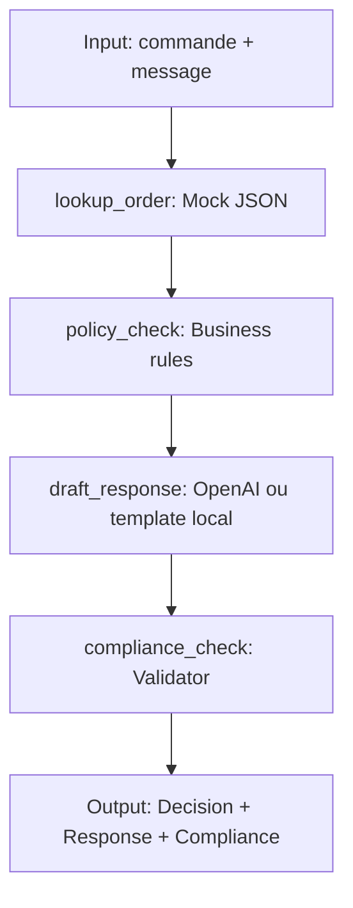

# ReturnGuard AI · Atelier pratique CI/CD

> **Agent-assisté, règles métier déterministes, contrôle de conformité et tests automatisés.**
> Projet pédagogique de 90 minutes : **LangGraph + Pytest + GitHub Actions**.

<!-- Change USERNAME/REPO to your real public repository path after uploading. -->
[](https://github.com/USERNAME/REPO/actions/workflows/ci.yml)

## Problématique

Un service client reçoit des demandes de retour hétérogènes. Une réponse générée par IA peut inventer une décision, garantir un remboursement, ou ignorer les conditions de retour. **Comment automatiser sans perdre le contrôle métier ?**

ReturnGuard AI donne une décision traçable (via règles explicites), prépare un message client (OpenAI facultatif), puis valide et corrige les sorties non conformes.

## Architecture



La **décision est déterministe**. Seule la rédaction est optionnellement confiée à un modèle. Un modèle ne peut pas valider lui-même un remboursement.

### Politique métier fictive

- `ELIGIBLE` : commande livrée, article standard, de 0 à 30 jours inclus, pas d'incident déclaré.
- `NOT_ELIGIBLE` : catégorie fictivement exclue (`hygiene`, `digital`) ou délai supérieur à 30 jours.
- `HUMAN_REVIEW` : commande introuvable, non livrée, données invalides, catégorie inconnue, message vide ou incident/produit défectueux.
- **Important :** l'éligibilité au *retour* n'équivaut jamais à un remboursement effectué. Ce barème est inventé pour l'atelier ; il ne décrit pas les droits légaux des consommateurs.

## Installation rapide

Python **3.12 ou 3.13** recommandé. Depuis le dossier du projet :

```bash
python -m venv .venv
# Windows PowerShell : .venv\Scripts\Activate.ps1
# Windows CMD : .venv\Scripts\activate.bat
# Linux/macOS : source .venv/bin/activate
python -m pip install -r requirements.txt
```

## Démo (sans aucune clé API)

```bash
python demo.py CMD-1001 "Bonjour, je souhaite retourner mon produit."
python demo.py CMD-1003 "Je veux retourner ma commande."
python demo.py CMD-1001 "Le produit est cassé."
python demo.py CMD-9999 "Je souhaite un retour."
```

L'application fonctionne sans clé API via un **générateur de réponse simulé / template déterministe**. Pour tester une vraie génération OpenAI, configurez `OPENAI_API_KEY` dans votre environnement (sans jamais l'ajouter à Git) et éventuellement `OPENAI_MODEL`. Une sortie incorrecte est remplacée automatiquement par un template conforme.

## Tests et rapport

```bash
python -m pytest tests -v --junitxml=reports/results.xml --cov=returnguard --cov-report=xml:reports/coverage.xml --cov-report=term-missing
python build_report.py
```

Ouvrir `reports/report.html` dans un navigateur pour voir le rapport des tests. Les tests simulent des commandes, des réponses conformes, des réponses incorrectes et des pannes de rédacteur.

## JSON export du workflow

```bash
python export_workflow.py
```

Voir `workflow_export.json` : architecture, nœuds, connexions, métadonnées métier. **C'est un export JSON de description du graphe, pas un JSON importable directement dans l'interface AgenticAI ou dans LangGraph.** Le workflow exécutable est `returnguard/workflow.py`.

## Github Actions / CI

1. Créer un dépôt GitHub nommé `ReturnGuard-AI` (public si vous voulez afficher librement le badge).
2. Ajouter **tout le contenu de ce dossier**, y compris le dossier caché `.github/workflows/`.
3. Remplacer `USERNAME/REPO` dans ce README par votre compte et votre dépôt.
4. Aller dans **Actions → Business Tests** ; le workflow se lance à chaque push et pull request, ou manuellement.
5. Ouvrir le run → **Artifacts → returnguard-test-report** pour télécharger le rapport HTML et le JUnit XML.
6. Une fois le job terminé avec succès, le badge sera vert sur le README (si GitHub le rend accessible).

**Ne pas mettre de clé API en dur** : la CI n'en a pas besoin.

## Livrables de l'atelier

| Exigence | Fichier / preuve |
|---|---|
| Workflow final | `returnguard/workflow.py`, `workflow_export.json` |
| Documentation | `README.md`, `docs/GUIDE_ATELIER.md` |
| Plus de 20 cas de test | `tests/test_policy.py`, `tests/test_compliance.py`, `tests/test_langgraph.py` |
| Rapport de tests | `reports/report.html`, `reports/results.xml` après exécution |
| Pipeline GitHub Actions | `.github/workflows/ci.yml` |
| Badge de réussite | badge GitHub réel après premier run réussi |
| Documentation des mocks | `docs/MOCKS.md`, `mocks/orders.json` |

## Limites

Ce MVP ne gère pas un vrai système de paiement, n'accède à aucune base client réelle, et n'exécute jamais de remboursement. Le détecteur d'incidents emploie des mots-clés simples ; il est volontairement limité et peut mal gérer certaines négations.
